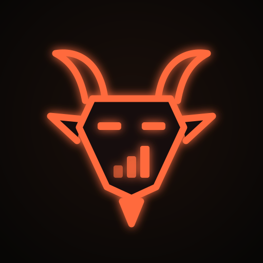
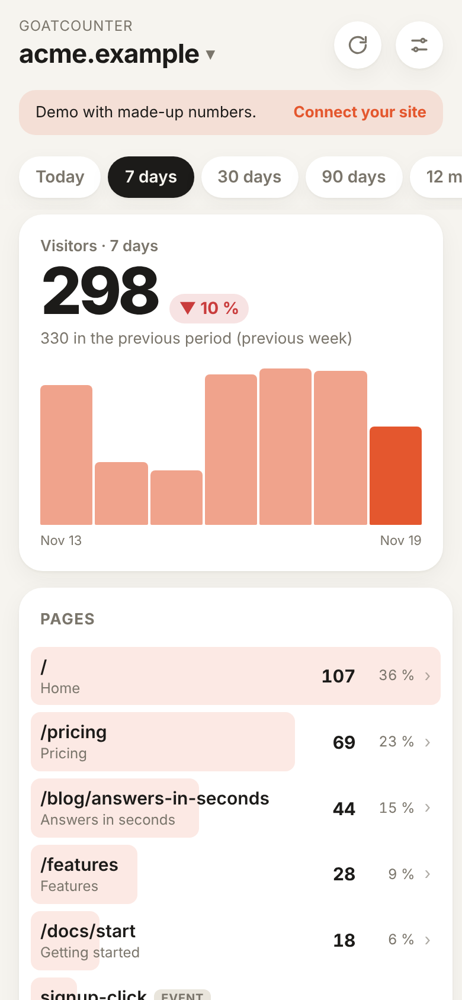

<p align="center">
  
</p>

<h1 align="center">GoatPocket</h1>

<p align="center">
  <b>Your <a href="https://www.goatcounter.com">GoatCounter</a> stats, made for your phone.</b><br>
  A fast, installable dashboard – static files only, no backend, no tracking.
</p>

<p align="center">
  <a href="https://goatpocket.com">Website</a> ·
  <a href="https://app.goatpocket.com/?demo">Live demo</a> ·
  <a href="docs/help.md">Help</a> ·
  <a href="docs/self-hosting.md">Self-hosting</a> ·
  <a href="CONTRIBUTING.md">Contributing</a>
</p>

<p align="center">
  <a href="https://github.com/TobiasWust/goatpocket/actions/workflows/ci.yml"></a>
  <a href="LICENSE"></a>
</p>

<p align="center">
  
</p>

## Features

- **Made for thumbs** – big numbers, a chart you can scrub with your finger, tap any row for a breakdown
  (pages → referrers, browsers → versions, locations → regions, …).
- **All the cards** you know from GoatCounter: pages, referrers, locations, browsers, systems, sizes, languages and
  campaigns, for today, 7, 30, 90 days or 12 months, compared to the period before.
- **Multiple sites and accounts** – a site switcher with visitor counts side by side; sites with their own login can be
  added with their own token.
- **Private by design** – the token is stored only in your browser and sent only to your GoatCounter instance. There is
  no GoatPocket server.
- **Installable PWA** with an offline-ready app shell, light and dark mode.
- **English and German**, picked from your browser (switchable in the settings).
- **Respects GoatCounter's rate limit**: requests are throttled, retried and cached for five minutes.
- **Works with self-hosted GoatCounter** on any HTTPS domain.

## Quick start

1. In GoatCounter, open **User → API** and create a token with **Read statistics** (and optionally **Read sites** for
   the site switcher).
2. Open [app.goatpocket.com](https://app.goatpocket.com/), enter your site code (`mysite` for
   `mysite.goatcounter.com`) or your own domain, and paste the token.
3. Add it to your home screen: **Share → Add to Home Screen** on iOS, **Install app** on Android/desktop.

Just curious? Try the [demo with made-up numbers](https://app.goatpocket.com/?demo).

More in the [help](docs/help.md), including troubleshooting.

## How it works

GoatPocket is a static web app. The browser calls the
[GoatCounter API](https://www.goatcounter.com/help/api) (`/api/v0/stats/…`) directly – GoatCounter sends CORS headers
that allow this – and renders the results. Everything the app remembers (accounts, selected range, a five-minute
response cache) lives in `localStorage` on your device.

```
index.html          landing page
legal.html          privacy policy and imprint (German)
app/                the app (index.html, style.css, js/ modules)
icons/              app icons
assets/             landing page styles, scripts and screenshots
sw.js               service worker (network first, cache as fallback)
docs/               help and self-hosting guide
test/               unit tests (node --test)
```

## Development

No build step, no runtime dependencies. You need a static file server and, for linting and tests, Node.js ≥ 20.11.

```bash
npm install     # dev tools only: ESLint + Prettier
npm start       # http://localhost:4173 (or: python3 -m http.server 4173)
npm test        # unit tests
npm run lint    # ESLint + Prettier check
```

Open `http://localhost:4173/app/?demo` to work without a GoatCounter account. See [CONTRIBUTING.md](CONTRIBUTING.md)
for the code tour and how to add a translation.

## Self-hosting

Copy the repository to any static host – Netlify, GitHub Pages, Cloudflare Pages, nginx, Caddy, a bucket. The
[self-hosting guide](docs/self-hosting.md) has examples and the recommended security headers.

## Related

- [GoatCounter](https://github.com/arp242/goatcounter) – the privacy-friendly analytics platform this app is built for.
  GoatPocket is an independent project and not affiliated with GoatCounter. If GoatCounter is useful to you, consider
  [supporting it](https://www.goatcounter.com/contribute).

## Support

GoatPocket is free, open source and ad-free. If it's useful to you, you can
[buy me a coffee on Ko-fi](https://ko-fi.com/tobiaswust) ☕

## License

[MIT](LICENSE) © Tobias Wust · [Datenschutz & Impressum](https://goatpocket.com/legal.html)

---

Made with ❤️ by [Wust](https://wust.dev/)
